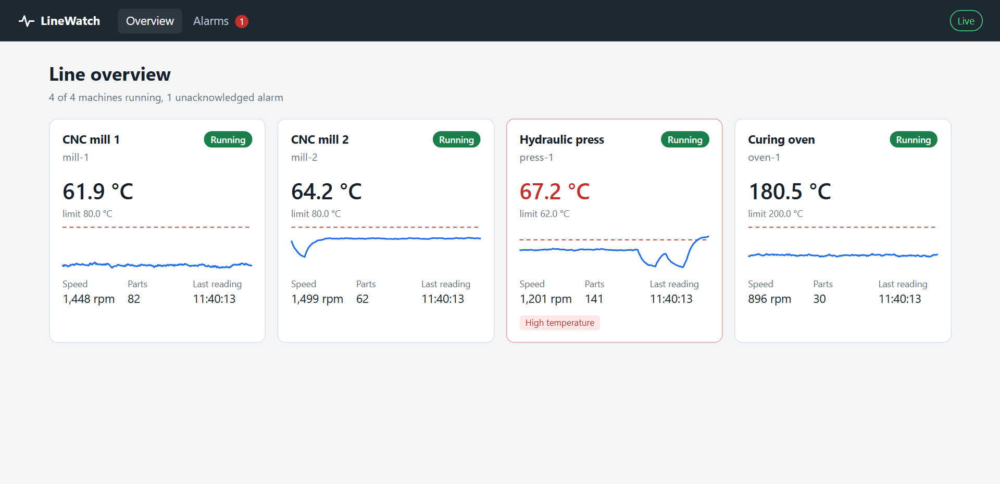
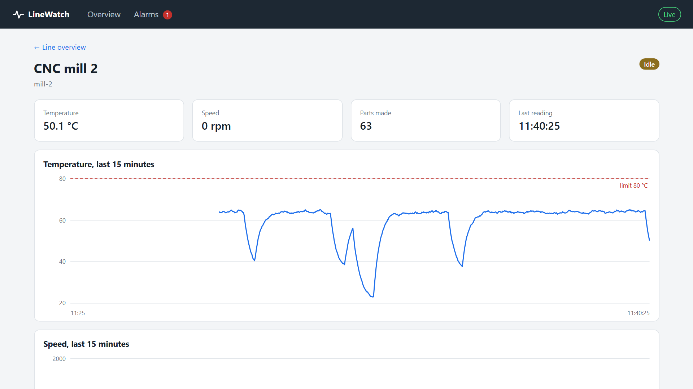
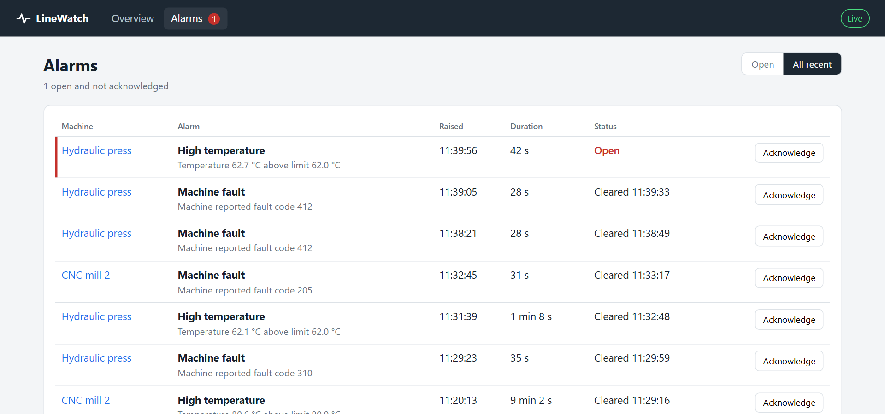

<div align="center">


# LineWatch

**Live monitoring for a small production line: machines over Modbus TCP, alarms with hysteresis, a dashboard that updates as it happens.**

[](https://github.com/pawelnowicki87/linewatch/actions/workflows/ci.yml)




</div>

## What you are looking at

Four simulated machines (two CNC mills, a hydraulic press and a curing oven) expose their state through **Modbus TCP**, the protocol most PLCs and industrial devices speak. A collector polls them every second, stores the readings in PostgreSQL, decides when alarms start and end, and pushes every change to the browser over **SignalR**.

- **Real protocol, not a mock API.** The simulator is a Modbus TCP server and the collector is a Modbus client. Point the collector at a real device that exposes the same register map and nothing else changes.
- **Alarms that behave like an operator expects.** One alarm per incident, not one per poll. A temperature hovering around its limit does not flap, because the alarm only clears below a hysteresis band. A machine that stops answering raises *communication lost* after a few failed polls, not on the first timeout.
- **Alarms survive restarts.** Open alarms are reloaded on startup, and a partial unique index in PostgreSQL makes "two open alarms of the same kind on one machine" impossible, not just unlikely.
- **The dashboard catches up after a disconnect.** It loads a snapshot over REST, then follows the SignalR stream, and reloads the snapshot whenever the connection comes back.
- **One language end to end.** The API, the simulator and the Blazor WebAssembly dashboard share the same C# records for readings, statuses and alarms.

| Machine detail | Alarms |
|---|---|
|  |  |

## Architecture

```
Blazor WebAssembly dashboard (browser)
   │  REST: snapshot, history, acknowledge        ▲ SignalR: MachineUpdated, AlarmChanged
   ▼                                              │
LineWatch.Api :5080 ──────────────────────────────┘
   │   ModbusPoller (BackgroundService, every 1 s)
   │     read registers ─► decode ─► AlarmTracker ─► save ─► broadcast
   │
   ├── Modbus TCP ──► LineWatch.Simulator :5020   unit 1 mill-1 · unit 2 mill-2
   │                                              unit 3 press-1 · unit 4 oven-1
   └── EF Core ────► PostgreSQL: readings (24 h retention) · alarms
```

**Why polling, and why push to the browser:**

| | Used for | Why |
|---|---|---|
| **Polling** (Modbus TCP) | collector → machines | Modbus is request/response: a device answers, it never calls you. Polling on a fixed timer also gives evenly spaced samples. |
| **Push** (SignalR) | API → dashboards | Dashboards should not poll the API every second each. The API already knows when something changed and tells everyone once. |

### Register map

Every machine exposes six holding registers starting at address 0, big-endian as Modbus defines it.

| Address | Meaning | Encoding |
|---|---|---|
| 0 | State | 0 idle, 1 running, 2 fault |
| 1 | Temperature | signed, tenths of a degree Celsius |
| 2 | Speed | rpm |
| 3–4 | Part counter | unsigned 32-bit, high word first |
| 5 | Fault code | 0 when there is no fault |

## Tech stack

**Backend:** .NET 10 · ASP.NET Core minimal APIs · SignalR · Entity Framework Core 10 + Npgsql · FluentModbus · BackgroundService + PeriodicTimer
**Frontend:** Blazor WebAssembly · SignalR client · hand-written SVG charts
**Testing:** xUnit · WebApplicationFactory · Testcontainers (PostgreSQL) · an in-process Modbus server
**Infrastructure:** Docker · Docker Compose · nginx · GitHub Actions

## Running it

Requires Docker. For running outside containers you also need the .NET 10 SDK.

**Everything in containers:**

```bash
docker compose -f docker-compose.full.yml up --build -d
```

Then open <http://localhost:5081>. The simulator injects changeovers, faults and overheating at random, so give it a few minutes and alarms will start to appear.

**Developing locally** (PostgreSQL in Docker, the rest with `dotnet run`):

```bash
docker compose up -d
dotnet run --project src/LineWatch.Simulator
dotnet run --project src/LineWatch.Api
dotnet run --project src/LineWatch.Dashboard
```

The API applies its EF Core migrations on startup. In Development the OpenAPI document is at <http://localhost:5080/openapi/v1.json>.

**Tests:**

```bash
dotnet test
```

The API tests start PostgreSQL with Testcontainers, so Docker has to be running. They also start a Modbus server inside the test process and drive the collector through it: register in, REST response and SignalR message out.

## API

| Method | Path | |
|---|---|---|
| GET | `/api/machines` | Latest status of every machine |
| GET | `/api/machines/{id}` | One machine |
| GET | `/api/machines/{id}/readings?minutes=15` | History, up to 60 minutes |
| GET | `/api/alarms?open=true&machineId=mill-1&limit=50` | Alarms, newest first |
| POST | `/api/alarms/{id}/acknowledge` | Acknowledge an alarm; repeated calls keep the first timestamp |
| GET | `/health` | Health check including the database |
| WS | `/hubs/telemetry` | SignalR hub: `MachineUpdated`, `AlarmChanged` |

## Project layout

```
src/
  LineWatch.Core         register map, alarm rules, contracts shared by API and dashboard
  LineWatch.Simulator    Modbus TCP server with four simulated machines
  LineWatch.Api          collector, EF Core, REST endpoints, SignalR hub
  LineWatch.Dashboard    Blazor WebAssembly, served by nginx in Docker
tests/
  LineWatch.Core.Tests   register decoding, alarm transitions and hysteresis
  LineWatch.Api.Tests    end-to-end through Modbus, PostgreSQL, REST and SignalR
```

## Deliberately left out

- **Authentication.** Anyone who can open the dashboard can acknowledge an alarm, and the alarm does not record who did it.
- **Long history.** Readings are kept for 24 hours and charts show up to an hour of raw points. Longer windows would need downsampling, for example with TimescaleDB continuous aggregates.
- **Machines in the database.** The machine list lives in configuration, which is enough for a fixed line but not for adding machines at runtime.
- **More than one API instance.** The collector and the SignalR hub assume a single instance; scaling out would need a backplane and one elected collector.
